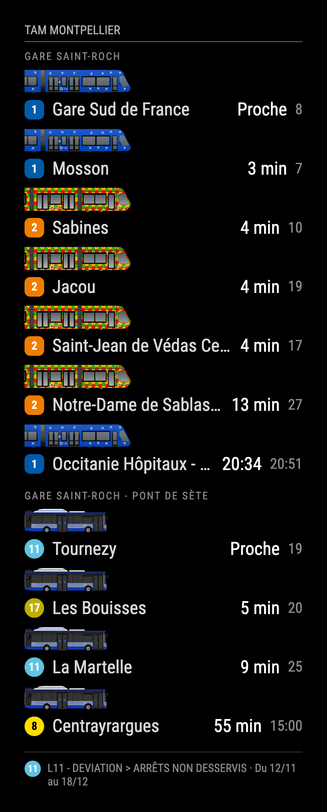
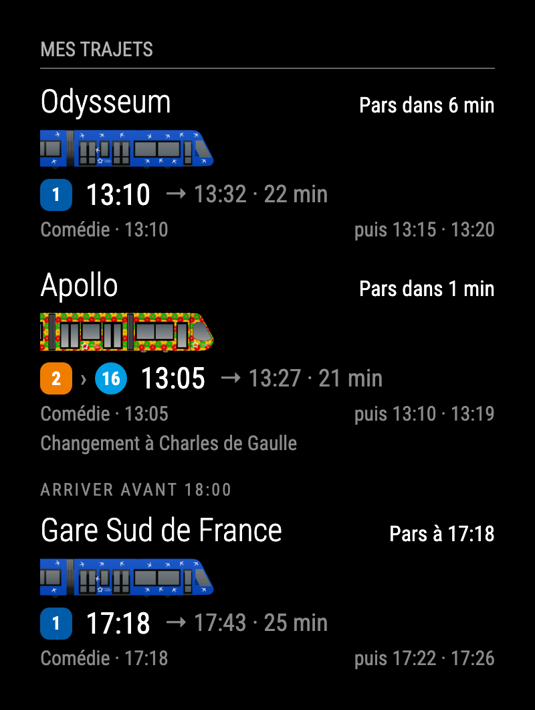

# MMM-TamTramBus

Module [MagicMirror²](https://magicmirror.builders) pour les **trams et bus de Montpellier** (TaM), branché sur l'API [TamTramBus](https://tamtrambus.bounsbot.com) : passages en temps réel, image du véhicule qui arrive, perturbations et trajets enregistrés.

<table>
<tr>
<th>Prochains passages (<code>departures</code>)</th>
<th>Mes trajets (<code>journeys</code>)</th>
</tr>
<tr>
<td valign="top"></td>
<td valign="top"></td>
</tr>
</table>

## Fonctionnalités

- 🚋 **Prochains passages** à vos arrêts, regroupés par ligne et direction, avec l'image du tram ou du bus qui arrive : le vrai véhicule quand il est suivi en temps réel (livrées spéciales comprises), sinon celui de la ligne.
- 🗺️ **Trajets enregistrés** depuis chez vous : l'heure à laquelle partir, la marche jusqu'à l'arrêt, les correspondances, et les départs suivants. Possibilité de viser une heure d'arrivée (`arriveBy`).
- ⚠️ **Perturbations** des lignes affichées uniquement.
- ⏱️ Minutes restantes recalculées toutes les 15 secondes ; l'API est interrogée chaque minute (deux pour les trajets). En cas de coupure, les derniers horaires restent affichés.
- 🎨 Design sobre, aux couleurs officielles des lignes, pensé pour se fondre avec les modules par défaut.
- 🌍 Français et anglais. Aucune dépendance, aucune clé d'API.

Une instance par mode : mettez-en plusieurs pour avoir les deux.

## Installation

```sh
cd ~/MagicMirror/modules
git clone https://github.com/FabienBounoir/MMM-TamTramBus.git
```

Aucune dépendance (Node 18 ou plus).

## Configuration

```js
{
	module: "MMM-TamTramBus",
	position: "top_left",
	header: "TAM Montpellier",
	config: {
		mode: "departures",
		stops: ["41143", "9234", "9249"],
		lineBlacklist: ["4", "Amigo"]
	}
},
{
	module: "MMM-TamTramBus",
	position: "top_left",
	header: "Mes trajets",
	config: {
		mode: "journeys",
		from: "1 rue de la Loge, Montpellier",
		destinations: [
			{ name: "Odysseum" },
			{ name: "Apollo" },
			{ name: "Comédie", arriveBy: "18:00" }
		]
	}
}
```

| Option | Défaut | Description |
| --- | --- | --- |
| `mode` | `"departures"` | `"departures"` ou `"journeys"` |
| `stops` | `[]` | Codes d'arrêt (ceux de la TaM, ou les `id` renvoyés par `/v1/search`) |
| `lineBlacklist` | `[]` | Lignes à masquer |
| `maxTimes` | `3` | Passages affichés par ligne et direction |
| `showAlerts` | `true` | Perturbations des lignes affichées |
| `from` | `""` | Point de départ des trajets : adresse, code d'arrêt ou `"lat,lng"` |
| `destinations` | `[]` | `{ name, to?, arriveBy? }` : `to` = nom d'arrêt, code ou `"lat,lng"` (par défaut `name`), `arriveBy` = `"HH:MM"` |
| `showVehicles` | `true` | Image du véhicule (tram : l'avant seulement, bus : en entier) |
| `updateInterval` | `60000` | Rafraîchissement de l'API (ms) |
| `apiUrl` | `"https://tamtrambus.bounsbot.com"` | Adresse de l'API |

Pour trouver un code d'arrêt : `https://tamtrambus.bounsbot.com/v1/search?q=Comédie`.
Les passages qui arrivent en terminus à votre arrêt sont ignorés.

## Test

```sh
node test.js
```

## Licence

MIT
